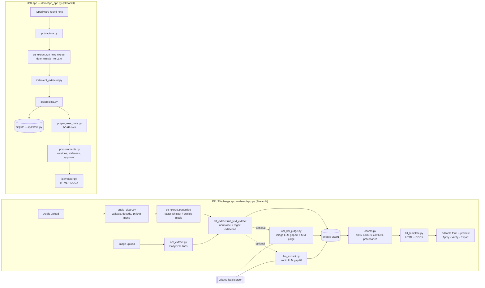

# MediBytes

## AI-Assisted Clinical Documentation and Inpatient Progress Note System

**Final Project Report — Prototype Demonstration**

| | |
|---|---|
| Report date | 15 October 2026 |
| Prepared for | Project Lead / Client |
| Repository | https://github.com/AjayAnandx/Medibytes |
| Branch documented | `fix/bug-cleanup` (working tree, including uncommitted changes) |
| Team members | [TO BE FILLED IN] |
| Status | Research / demonstration prototype — **not** clinically validated, **not** for real patient care |

---

## Executive Overview (one page)

**The problem.** Clinicians spend a large share of their time turning spoken observations, handwritten prescriptions and ward-round notes into structured documentation. Errors in that transcription step — wrong doses, lost allergies, misread vital signs — carry direct patient-safety risk.

**What MediBytes is.** A locally run prototype with two Streamlit applications:

1. **ER / Discharge application** (`demo/app.py`) — turns an **audio dictation** or a **prescription image** into an **editable ER discharge-note draft** with source evidence, colour-coded review status, clinician corrections, an audit trail, a verification gate and HTML/DOCX export.
2. **IPD Intelligence application** (`demo/ipd_app.py`) — admits **synthetic** inpatients, turns **typed ward-round notes** into a **timeline of clinical events**, and generates a versioned **SOAP progress note** that a clinician approves and exports.

**How it works (in brief).** Audio is cleaned and transcribed with faster-whisper (Whisper on CPU); images are read with EasyOCR; rule-based (regex) extraction produces a deterministic baseline; an optional **local** LLM (Ollama, default `llama3.2:3b`) only fills gaps and evaluates fields, and its suggestions are labelled. The IPD module stores events in SQLite.

**Safety design.** Missing values are shown in red as `NIL`; uncertain or AI-suggested values are yellow and labelled; conflicts are flagged rather than resolved; corrected exports unlock only after clinician verification and are invalidated when the note changes; IPD notes require explicit approval by a clinician role.

**Status.** The prototype runs end-to-end on a single Windows laptop. On the documented branch, the automated suite reports **442 tests passed and 40 subtests passed** (`python -m pytest demo/tests -q`, run 15 Oct 2026). During this review cycle **16 issues** (Section 10) — several of them clinical-safety relevant — were fixed and covered by regression tests. These fixes are **uncommitted on `fix/bug-cleanup` and are not yet in `main`**.

**What it is not.** MediBytes has **not** been clinically validated, has no measured accuracy figures, no authentication, and makes no regulatory or compliance claims. All demonstrations use synthetic data. Every generated document is a **draft that a clinician must review**.

---

## Table of Contents

1. Executive Summary
2. Problem Statement and Objectives
3. Project Scope
4. System Architecture
5. Technology Stack
6. Module 1 — Audio-to-Discharge-Note Workflow
7. Module 2 — Prescription Image OCR Workflow
8. Module 3 — IPD Ward Round and Progress Notes
9. End-to-End Demonstration Flow
10. Key Engineering Improvements and Bugs Fixed
11. Testing and Quality Assurance
12. Security, Safety and Responsible AI
13. Current Limitations and Known Issues
14. Future Enhancements (Future Work)
15. Installation and Running the Demo
16. Project Status and Git Summary
17. Conclusion
18. Appendix

---

## 1. Executive Summary

**Problem addressed.** Emergency and inpatient documentation is repetitive and error-prone. Dictations must be transcribed, prescriptions re-typed, and daily ward-round findings consolidated into progress notes. Each manual step can drop or distort clinically important facts such as doses, vital signs and allergies.

**What MediBytes delivers.**

| Capability | Where | Status on `fix/bug-cleanup` |
|---|---|---|
| Audio upload → cleaned audio → transcript → clinical entities → discharge-note draft | `demo/app.py`, `demo/audio_clean.py`, `demo/stt_extract.py` | Implemented; automated tests use mocked STT |
| Prescription image → OCR text → entities → discharge-note draft, with AI evaluation table | `demo/ocr_extract.py`, `demo/ocr_llm_judge.py` | Implemented; real OCR verified on a synthetic image |
| Editable draft, audit trail, verification gate, HTML/DOCX export | `demo/app.py`, `demo/fill_template.py`, `demo/coords.py` | Implemented and covered by app-level tests |
| IPD admission, typed ward rounds, event timeline, SOAP progress note, approval, export | `demo/ipd_app.py`, `demo/ipd/` | Implemented; 248+ IPD tests |
| Optional local LLM gap-fill and field evaluation | `demo/llm_extract.py`, `demo/ocr_llm_judge.py` | Implemented; tests use faked LLM output; one real local run observed |

**Prototype status.** Functional demonstration prototype, verified by automated tests and limited manual/headless checks. Not production-ready and not clinically validated.

---

## 2. Problem Statement and Objectives

### 2.1 Problems

- **Manual documentation burden.** Clinicians re-enter information that already exists as speech or paper.
- **Unstructured inputs.** Dictations mix languages (e.g. Hinglish) and contain mishearings; prescriptions are printed or handwritten images.
- **Inpatient continuity.** Ward-round findings accumulate across days and must be summarised into progress notes that reflect the current state, including corrections.
- **Accountability.** Any AI-produced draft must show where each value came from and must not be mistaken for a clinician-approved record.

### 2.2 Objectives

1. Convert **voice dictations** and **prescription images** into structured, editable discharge-note drafts.
2. Keep **source evidence** (heard sentence or OCR line) and a visible **review status** for each field.
3. Never invent values: show missing information as missing, flag conflicts and label AI suggestions.
4. Track **inpatient ward-round events** on an append-only timeline and generate **SOAP progress notes**.
5. Require **clinician verification/approval** before final exports, with an **audit trail** of corrections.
6. Run **locally** on a CPU laptop, without cloud APIs in the application code.

---

## 3. Project Scope

### 3.1 In scope (implemented)

| Area | Description |
|---|---|
| ER / discharge workflow | Single-page A4 ER discharge-note draft: chief complaint, medications (up to 2 rows on the A4 note; further extracted drugs appear in the Entities tab only), vitals (BP, temperature, SpO2), allergies, diagnosis/ICD-10 box, follow-up, signature line |
| Audio transcription | `.wav`, `.mp3`, `.m4a` upload (≤100 MB, ≤30 min decoded audio); faster-whisper `tiny`/`base`/`small` int8 on CPU; explicit synthetic "mock" mode |
| Prescription image OCR | `.png`, `.jpg`, `.jpeg`; EasyOCR (English); verbatim lines with per-line confidence |
| Clinical entity extraction | Regex/rule baseline for drugs (30-drug mini list + aliases), doses, units, frequency, duration, vitals, symptoms, allergies, negations, diagnosis, follow-up; optional local LLM gap-fill |
| Discharge-note generation | Jinja2 HTML (A4, coordinate slots) and python-docx DOCX |
| IPD ward-round workflow | Synthetic admission, typed ward-round capture, event extraction, timeline with correction/retraction, SOAP note generation, versioning, staleness, approval, HTML/DOCX export |

### 3.2 Out of scope (not implemented)

- Use with **real patient data**, clinical deployment or clinical validation.
- Authentication, user accounts, role enforcement by login (clinician IDs are typed free text).
- Integration with hospital systems (HIS/EMR, HL7/FHIR), terminology services (RxNorm, SNOMED, full ICD-10 coding).
- Live microphone recording (the UI accepts file uploads only).
- Audio or OCR input into the IPD module (IPD accepts typed text only).
- A single combined interface for ER and IPD (they are separate apps).
- Discharge of IPD encounters and bed-occupancy management.
- Automated PDF generation (PDF is produced manually by printing the verified HTML).

---

## 4. System Architecture

### 4.1 Components



### 4.2 Separate entry points

| App | Command (from repository root) | Purpose |
|---|---|---|
| ER / Discharge | `python -m streamlit run demo/app.py` | Audio and image → discharge-note draft |
| IPD Intelligence | `python -m streamlit run demo/ipd_app.py` | Ward rounds → timeline → progress note |
| CLI pipeline | `python demo/pipeline.py --in <audio> --key <job> ...` | Audio → files without the UI |
| One-command demo | `python run_demo.py [--no-install]` | Installs dependencies (unless `--no-install`), warms cached samples, launches the ER app |

The two Streamlit apps are **independent**: they run as separate processes (on different ports if both are open). They share the extraction function `stt_extract.run_text_extract`; the IPD module calls it in deterministic mode with the LLM disabled.

### 4.3 Storage and data flow

| Data | Location | Notes |
|---|---|---|
| Uploaded audio | System temp folder | Copied for processing |
| Audio job outputs | `demo/cleaned/`, `demo/transcripts/`, `demo/entities/`, `demo/exports/` | File-based "demo database"; live uploads add files here |
| Corrections & audit | `demo/entities/{job}.audit.json`, `{job}.corrected.entities.json` | Append-only audit trail per job |
| Verified exports | `demo/exports/{job}.corrected.html/.docx` + `.corrected.verified.json` manifest | Outdated copies are moved to `*.corrected.superseded-*` (kept, not deleted) |
| Image (OCR) jobs | Streamlit session memory only | Nothing written to disk; downloads generated in memory |
| IPD data | SQLite file **outside the repository**: `%LOCALAPPDATA%\MediBytes\ipd_demo.sqlite`, or the path in `MEDIBYTES_IPD_DB` | Events, source records and audit log are append-only (enforced by database triggers) |

### 4.4 Local AI integration

The application code calls the **local** `ollama` command-line tool (`ollama list`, `ollama run --format json <model>`). No cloud AI API is called from the application code (verified by source search). Third-party libraries may download model files on first use: faster-whisper downloads Whisper weights, and EasyOCR downloads its detection/recognition models.

---

## 5. Technology Stack

Only dependencies verified in `demo/requirements-demo.txt` and in actual imports are listed.

| Layer | Technology | Used in |
|---|---|---|
| Language | Python (verified on 3.11.9; README targets 3.13) | All modules |
| UI | Streamlit 1.40.0 | `demo/app.py`, `demo/ipd_app.py`, `demo/ipd/ui.py` |
| Audio decode | soundfile 0.13.1, imageio-ffmpeg 0.6.0 (bundled ffmpeg), numpy | `demo/audio_clean.py` |
| Speech-to-text | faster-whisper 1.2.1 (CPU, int8; `tiny`/`base`/`small`) | `demo/stt_extract.py` |
| OCR | EasyOCR 1.7.2 (English), Pillow | `demo/ocr_extract.py` |
| Local LLM | Ollama CLI; default model `llama3.2:3b` (UI also lists `qwen2.5:0.5b`) | `demo/llm_extract.py`, `demo/ocr_llm_judge.py`, `demo/stt_extract.py` |
| Templates | Jinja2 3.1.4 | `demo/fill_template.py`, `demo/ipd/render.py` |
| DOCX | python-docx 1.1.2 | `demo/fill_template.py`, `demo/ipd/render.py` |
| Charts | matplotlib 3.9.2 (waveforms) | `demo/app.py` |
| Persistence | SQLite (Python standard library `sqlite3`) | `demo/ipd/store.py` |
| Testing | pytest (unittest-style IPD tests also run under pytest); Streamlit `AppTest` for UI flows | `demo/tests/` |

Optional, not installed by default: noisereduce/scipy (denoise), spaCy (unused effect). pytest is installed separately (`python -m pip install pytest`).

---

## 6. Module 1 — Audio-to-Discharge-Note Workflow

### 6.1 Upload

The sidebar accepts `.wav`, `.mp3` and `.m4a`. Three cached samples are also selectable (`demo-001`, `demo-002`, `luvvoice-001`). Results persist across Streamlit reruns; each upload receives a job ID derived from the file name and content hash, so different files never share state.

### 6.2 Validation and preprocessing (`demo/audio_clean.py`)

- Size limit 100 MB; **decoded** duration limit 30 minutes for every format (header metadata is not trusted; decoding stops just past the limit).
- Rejects empty, corrupt or unsupported files with explicit `422` messages, and silent or near-silent audio.
- Converts to 16 kHz mono and normalises loudness.
- Metadata reports **level measurements only** (`input_rms_dbfs`, `input_peak_dbfs`, `input_clipped_ratio`), an energy-based `vad_ratio`, and whether denoising actually ran. No signal-to-noise ratio is claimed.

### 6.3 Speech-to-text (`demo/stt_extract.py`)

- faster-whisper on CPU with word timestamps.
- Segment confidence = `exp(avg_logprob)`, labelled as an **uncalibrated heuristic** in 0–1; missing or invalid values are left empty.
- If transcription fails (model missing, decode error), the app shows an error and produces **no** transcript, entities or note. A synthetic script is used **only** when the user explicitly selects the "mock" model, and is labelled "SYNTHETIC transcript … not your audio".

### 6.4 Normalisation and extraction

- Hinglish and shorthand normalisation (e.g. *bukhar → fever*, *BID → twice daily*), number-word conversion, narrow phonetic repairs (e.g. "BPA 130 by AC" → BP 130/80).
- Regex extraction of drugs (dose, unit, frequency, duration), vitals, symptoms with negation, allergies (active, denied, "no known allergies"), diagnosis and follow-up.
- Optional local LLM: gap-fills only fields the regex left empty; regex values always win; disagreements are recorded as conflicts.

### 6.5 Evidence, status and provenance

| Colour / label | Meaning |
|---|---|
| GREEN | Read directly from the source by deterministic rules |
| YELLOW | Needs a glance: fuzzy match, heuristic, or "AI-suggested - verify" |
| RED / `NIL` | Missing — must be completed before verification |
| RED + "CONFLICT" | Contradictory source information (e.g. allergy conflicts) |
| Notes | "multiple readings - verify", "AI read X - verify", "frequency from next OCR line - verify" |

The **Entities** tab shows each item with the sentence it was heard in.

### 6.6 Editable draft, verification and export

1. The **Discharge note** tab shows editable fields beside an A4 preview.
2. **Apply corrections** records only fields the clinician actually changed (including reverts) in the audit trail.
3. **Verify & unlock** is enabled only with ≥1 correction in the current run **and** no RED fields. Verification records a content fingerprint.
4. Any later change invalidates verification ("needs re-verification") and locks the corrected exports; outdated disk exports are moved to a `superseded` archive name.
5. Downloads: AI-original HTML; corrected HTML and DOCX after verification. PDF is produced manually by printing the verified HTML.

### 6.7 Error handling and limitations

Clear errors for oversized, overlong, corrupt or silent audio; transcription failure; and discharge-note template failure (no partial or empty note is ever produced). Speech-recognition errors remain possible; see Section 13.

---

## 7. Module 2 — Prescription Image OCR Workflow

1. **Upload**: select *Input source → Image* and upload a PNG/JPG/JPEG.
2. **OCR** (`demo/ocr_extract.py`): EasyOCR returns verbatim text grouped into lines in reading order, with the lowest confidence per line. Text is never spell-corrected.
3. **Source comparison**: the raw OCR text and per-line confidences are shown next to the uploaded image.
4. **Extraction**: the same rules run in image mode (each OCR line is a boundary; no fuzzy drug-name guessing). A line containing only a frequency directly below a medicine line is attached to that medicine and marked for review.
5. **AI-assisted extraction and evaluation** (`demo/ocr_llm_judge.py`, optional, local Ollama):
   - The LLM proposes values; each must be **verbatim in the OCR text** (digits and names), otherwise it is dropped.
   - Blood pressure is accepted only with an explicit BP label and never from dates.
   - A second LLM call acts as a **judge**, scoring each field **PASS / MISSING / UNPROVEN** against the cited OCR line; PASS requires the line to actually support the value.
6. **Uncertainty**: AI-filled values are YELLOW with "AI-suggested - verify"; missing fields remain RED `NIL`.
7. **Draft, verification and export**: the same editor, audit, verification and download flow as audio, held in session memory (nothing written to disk for image jobs).

**Observed behaviour (manual/headless check, synthetic image `demo/ocr_test/test.png`)**: OCR returned 9 lines in about 19 s; the regex extracted patient name, complaint, paracetamol 500 mg and temperature; a real local `llama3.2:3b` run took about 85 s and filled the frequency. These timings are single observations on one laptop, not benchmarks.

**Known limitations**: handwriting accuracy depends on EasyOCR and is not measured; drug names outside the 30-drug list are not extracted by rules in image mode; multi-line layouts beyond the frequency rule need the LLM or the clinician.

---

## 8. Module 3 — IPD Ward Round and Progress Notes

The IPD application (`demo/ipd_app.py`, `demo/ipd/`) is organised into six tabs: **A Patient / Admission, B Ward Round, C Timeline, D Progress Note, E Review / Approval, F Export**.

| Step | Behaviour (verified in code/tests) |
|---|---|
| Admission | Synthetic patients only (MRN must start with `DEMO-`). Creates patient, encounter, bed assignment, ADT event and audit entry in one transaction. Re-submitting an already-admitted MRN with identical details opens the existing encounter; different details are refused with an explanation (nothing written). |
| Ward-round capture | Typed text by a clinician role (consultant, resident, intensivist). Processing is deterministic (no LLM). Failures are recorded as failed captures, never reported as success. |
| Event extraction | Entities become events: symptoms (present/denied), vitals, diagnosis (provisional), medication orders (proposed, unverified), allergies (active/denied), follow-up. Duplicate facts are de-duplicated with stable IDs. |
| Timeline | Append-only. **Correction** creates a new event that supersedes the old one; **retraction** adds a retraction marker. Nothing is edited or deleted in place (enforced by database triggers). Conflicting values at the same time are flagged, never auto-resolved. |
| SOAP progress note | Generated from active events in a time window: S (symptoms), O (vitals), A (diagnosis), P (follow-up and *proposed* medications). Every line cites its source event IDs; empty sections show placeholders. |
| Review & approval | Versioned documents; wording edits are restricted; a version becomes **stale** when its underlying events change. Approval is refused for stale or conflicting versions and requires a consultant, resident or intensivist role. |
| Export | HTML and DOCX of the selected stored version, with the approval state of that version and a traceability table. |

**Document approval vs. event verification.** Approving a progress note records that a clinician approved that **document version**. It does **not** mark the individual extracted events as clinically verified — extracted medication orders, for example, remain "proposed / unverified" events on the timeline.

---

## 9. End-to-End Demonstration Flow

This walkthrough is designed for the project lead. **Demo videos were not available for this report and have not been reviewed.**

### 9.1 Preparation

- Use **synthetic data only**.
- For real transcription, the Whisper model must be downloaded once (internet required). It was **not** present on the audit laptop; without it, audio uploads correctly show "Speech-to-text failed", and the labelled synthetic sample `demo-002` can be used instead.
- For the IPD app, start with a fresh database (`MEDIBYTES_IPD_DB`, Section 15) so earlier test patients do not appear.

### 9.2 Audio demonstration (≈ 2 min)

1. Open the ER app, *Input source: Audio*.
2. Upload `demo scripts/luvvoice.com-20260921-LnWlf1.mp3` (synthetic text-to-speech) with STT `base-int8` — **or** select cached sample `demo-002` (labelled SYNTHETIC).
3. Show the Transcript tab (raw vs normalised), the Entities tab (evidence sentences, denied penicillin allergy), and the Discharge note tab with RED/YELLOW fields.

### 9.3 OCR demonstration (≈ 2 min)

1. *Input source: Image*, upload `demo/ocr_test/test.png` (synthetic), keep LLM evaluation on (or off for speed), **▶ Run OCR**.
2. Show the raw OCR text and confidences, the AI evaluation table (PASS/MISSING/UNPROVEN) and the note with "AI-suggested" labels.

### 9.4 Clinician review (≈ 1.5 min)

Fill the RED fields, **Apply corrections**, **Verify & unlock**, download corrected HTML/DOCX; then change a value and show the re-verification warning.

### 9.5 IPD demonstration (≈ 1.5 min)

Admit a new synthetic patient (e.g. `DEMO-0003`), paste a typed ward-round note, **Process Ward Round**, open the Timeline, **Generate Progress Note**, approve as a consultant, and export HTML/DOCX.

---

## 10. Key Engineering Improvements and Bugs Fixed

All items below are present in the **working tree of `fix/bug-cleanup`** and each is covered by regression tests (file names in brackets). They are **uncommitted and not in `main`**. This list does not imply that all defects have been found.

| # | Issue | Previous behaviour | Current behaviour | Tests |
|---|---|---|---|---|
| 1 | Upload persistence | Live-upload results disappeared after *Apply* or *Verify*; similar file names shared state | Results stored per upload (name + content hash) in session state | `test_app_upload_persistence.py` |
| 2 | AI overwriting regex vitals | One AI vital erased all regex vitals | Per-field merge; regex never overwritten; disagreements recorded as conflicts | `test_vitals_merge.py` |
| 3 | Silent synthetic transcript on STT failure | A demo fever script replaced the user's audio | Clear error; no note produced; mock only when explicitly selected and labelled | `test_stt_failure.py` |
| 4 | STT confidence | Inverted and unbounded (`-avg_logprob + 0.7`) | `exp(avg_logprob)` in 0–1, labelled uncalibrated; invalid → empty | `test_stt_confidence.py` |
| 5 | Duplicate vital signs | "99 percent" not recognised as SpO2; AI copy duplicated it | Recognised once; AI disagreement becomes a conflict | `test_vitals_duplicates.py` |
| 6 | Multiple different readings | Last reading shown silently | "Multiple readings — verify" with all values and sources | `test_vitals_multiple_readings.py` |
| 7 | MP3/M4A duration | M4A never checked; misleading MP3 headers passed | Limit enforced on decoded audio; bounded decode; clear errors | `test_audio_duration.py` |
| 8 | Audio-quality metadata | "SNR" was loudness + offset; fixed +6 dB "improvement"; denoise claimed when absent | Level measurements only; truthful denoise status | `test_audio_quality_meta.py` |
| 9 | Verification state | Untouched *Apply* created fake corrections; reverts not audited; OCR re-runs kept "Verified" | Only real changes audited; content fingerprint; invalidation recorded | `test_verification_state.py` |
| 10 | Stale corrected exports / prior-run corrections | Old "verified" files stayed in place; earlier runs counted toward Verify | Outdated exports archived (not deleted); only current-run corrections count | `test_verification_exports.py` |
| 11 | Allergies | Positive allergies never extracted; "allergic to X, denies Y" inverted; missing vs "no known allergies" indistinguishable | Active/denied/NKA/not-documented distinguished; conflicts RED; AI allergens must appear in source | `test_allergies.py` |
| 12 | Template fallback | Failure produced an empty A4 form that could be exported as "verified" | Explicit error, no document; content check before rendering is accepted | `test_template_fallback.py` |
| 13 | AI-suggested provenance | AI-filled values could appear GREEN | Field-level provenance; never GREEN; "AI-suggested - verify" in note, HTML and DOCX until a clinician edits that field | `test_ai_provenance.py` |
| 14 | Dates read as blood pressure | "Prescription Date: 05/05/2023" became BP 05/05 and was judged PASS | BP requires an explicit label, rejects dates and implausible values; judge cannot cite a date | `test_bp_dates.py` |
| 15 | OCR medication frequency | Frequency on the next OCR line was lost | Frequency-only next line attached and marked for review | `test_bp_dates.py` |
| 16 | IPD admission mismatch | Existing MRN with different details reported success and showed the old bed | Refused with explanation; nothing written; confirmation messages no longer vanish | `test_ipd_admission_mismatch.py` |

Additional housekeeping on the branch: duplicate dependency lines removed and Pillow added to requirements; README corrections; removal from the working tree of two OCR sample images of unknown provenance and three obsolete live-run output files (Section 16).

---

## 11. Testing and Quality Assurance

### 11.1 Verified result

```powershell
python -m pytest demo/tests -q
```

**Result (15 Oct 2026, `fix/bug-cleanup` working tree): 442 passed, 40 subtests passed, 14 warnings, 0 failures.** The warnings are third-party deprecation messages from matplotlib/pyparsing.

Test counts grew during the review cycle (from 261 at the start of the bug-fix work) as regression tests were added; the figure above is the latest verified run.

### 11.2 Test categories

| Category | Files | Approx. test functions* |
|---|---|---|
| IPD Intelligence (store, encounter, capture, extractor, timeline, progress note, documents, render, UI) | `test_ipd_*.py` (10 files) | 253 |
| Extraction rules & vitals | `test_numerals.py`, `test_vitals_*.py`, `test_bp_dates.py` | 45 |
| Allergies & AI provenance | `test_allergies.py`, `test_ai_provenance.py` | 32 |
| OCR AI judge | `test_ocr_llm_judge.py` | 8 |
| Audio pipeline (STT failure, confidence, duration, metadata) | 4 files | 36 |
| Note rendering & verification (templates, verification, exports, upload persistence) | 4 files | 35 |

\*Counted from `def test` definitions; parametrised tests expand to more collected tests, which is why the collected total (442) is higher.

### 11.3 What the tests use

- **Synthetic** text, generated tones, and synthetic images only.
- **Fakes** for Whisper, Ollama and EasyOCR in most tests; temporary directories and databases so persistent demo data is not modified.
- Streamlit `AppTest` drives real UI flows (upload, Apply, Verify, exports, IPD admission and approval) without a browser.

### 11.4 What automated tests do NOT establish

- Transcription or OCR **accuracy** on real recordings, accents, noise or handwriting.
- Quality or reliability of real LLM output (tests use fixed fake responses).
- Clinical correctness, safety or usability with clinicians.
- Visual layout in a real browser, printing to PDF, or DOCX appearance in Word.
- Performance, scalability, security or concurrent use.

### 11.5 Manual / headless checks performed (not automated)

- Both Streamlit apps load without errors; the three cached samples render (headless `AppTest`).
- Real EasyOCR on `demo/ocr_test/test.png` (local models) and one real local `llama3.2:3b` image evaluation.
- Real Whisper transcription was **not** verified (model not downloaded on the audit machine).

---

## 12. Security, Safety and Responsible AI

| Principle | Implementation (verified) |
|---|---|
| Synthetic data only | IPD requires `DEMO-` MRNs and shows a "DEMO / SYNTHETIC DATA ONLY" banner; the ER app states "Demo only — verify before clinical use"; mock transcripts are labelled SYNTHETIC |
| Clinician verification | ER corrected exports unlock only after Verify (≥1 correction, no RED); IPD notes require approval by a clinician role |
| No invented values | Missing fields shown as `NIL`; allergy status "NOT DOCUMENTED" is never presented as "no known allergies"; AI values must appear in the source (OCR/transcript) |
| AI labelling | AI-filled values are YELLOW with "AI-suggested - verify" in the editor, HTML and DOCX |
| Uncertainty and conflicts | Conflicts and multiple readings are flagged, not resolved; IPD conflicts block approval |
| Audit trails | ER: per-job audit JSON (corrections, verification, invalidation, export archiving). IPD: append-only audit log in SQLite |
| Local processing | No cloud API calls in application code; LLM via local Ollama; STT/OCR run locally after one-time model download |

**Not provided:** authentication, encryption at rest, access control, secure deployment, penetration testing, or any regulatory compliance (e.g. HIPAA, GDPR, medical-device regulation). No patient-safety guarantee is made.

**Privacy note.** Two OCR sample images of unknown provenance that appeared to contain identifiable clinician/patient details were removed from the working tree as a precaution. They **remain in Git history and on remote branches**; full removal would require a coordinated history rewrite (Section 16).

---

## 13. Current Limitations and Known Issues

**Recognition and extraction**
- Speech recognition errors are possible; only narrow phonetic repairs exist. Real Whisper accuracy is not measured.
- Handwritten OCR accuracy is not measured and is expected to be variable.
- Rule-based drug extraction relies on a 30-drug list; other medicines need the LLM or manual entry.
- BP without an explicit "BP / blood pressure" label is not auto-filled (safer, but may require manual entry).
- The judge's evidence check for non-BP numeric fields (temperature, SpO2, dose) uses digit matching and could be fooled by unrelated numbers.
- Allergy reaction/severity is not modelled; only up to 3 denied items are drawn on the A4 page.

**AI**
- The LLM is optional and slow on CPU (tens of seconds per call); outputs vary between runs.
- AI suggestions do not block verification; they are labelled, and the clinician decides.

**Interface and output**
- Small A4 slots can visually clip notes; the full text is available in DOCX and the app.
- No microphone recording; separate ER and IPD apps; no integrated navigation.
- Cached demo samples were generated by older code (older metadata/exports, `luvvoice-001` vitals out of date).
- The second LLM option in the UI (`qwen2.5:0.5b`) may not be installed locally.
- One IPD confirmation message (progress-note generation) can disappear on rerun.

**IPD**
- No discharge workflow; admitted demo patients remain admitted.
- No bed-occupancy check; DOB/sex are not compared on re-admission attempts.
- Typed text only.

**Status**
- Prototype; no clinical validation, no performance benchmarks, no security hardening.

---

## 14. Future Enhancements (FUTURE WORK)

All items below are **proposals, not implemented**.

1. **Accuracy**: evaluate STT/OCR on representative synthetic and consented datasets; larger Whisper models; handwriting-specific OCR; expanded drug vocabulary (e.g. RxNorm).
2. **Evidence validation**: per-field evidence spans for every value; date/age-aware checks for all numeric fields; calibrated confidence.
3. **Clinician review policy**: optionally require explicit review of every AI-suggested value before verification.
4. **UI**: responsive layout, larger note fields, integrated ER ↔ IPD navigation, microphone capture.
5. **IPD**: discharge workflow, bed management, audio/OCR capture into the timeline.
6. **Security**: authentication, role-based access control, encryption, audit-log protection.
7. **Integration**: FHIR/HL7 export, terminology services, structured PDF/A output.
8. **Deployment & validation roadmap**: containerised deployment, monitoring, usability studies with clinicians, formal clinical validation and regulatory assessment before any real-world use.

---

## 15. Installation and Running the Demo

All commands are run from the repository root (the folder containing `README.md`). Verified on Windows with Python 3.11.9.

```powershell
cd <path-to>\Medibytes

# 1) Dependencies
python -m pip install -r demo/requirements-demo.txt
python -m pip install pytest            # tests only

# 2) Optional local LLM (Ollama installed separately)
ollama pull llama3.2:3b

# 3) Optional one-time Whisper model download (internet required)
python -c "from faster_whisper import WhisperModel; WhisperModel('base', device='cpu', compute_type='int8')"

# 4a) ER / Discharge app (Streamlit default port 8501)
python -m streamlit run demo/app.py --browser.gatherUsageStats false

# 4b) IPD app in a second terminal, fresh demo database, port 8502
$env:MEDIBYTES_IPD_DB = "$env:TEMP\medibytes_ipd_demo.sqlite"
python -m streamlit run demo/ipd_app.py --server.port 8502 --browser.gatherUsageStats false

# Alternative: python run_demo.py --no-install   (warms cached samples, launches the ER app)

# Tests
python -m pytest demo/tests -q
```

Notes:
- EasyOCR downloads its models on first use (cached locally afterwards).
- Without the Whisper model, audio uploads show "Speech-to-text failed"; the mock model and cached samples still work and are labelled synthetic.
- The IPD database is never stored inside the repository.

---

## 16. Project Status and Git Summary

| Item | Status (15 Oct 2026) |
|---|---|
| Current branch | `fix/bug-cleanup` |
| `main` / `origin/main` | `3e3fbab` — unchanged by this work |
| Committed on branch, not in `main` | `b1483dd` (IPD Intelligence feature) and merge `acafe7b` |
| Uncommitted modifications | `README.md`, `demo/app.py`, `demo/audio_clean.py`, `demo/coords.py`, `demo/fill_template.py`, `demo/ipd/ui.py`, `demo/llm_extract.py`, `demo/ocr_llm_judge.py`, `demo/pipeline.py`, `demo/requirements-demo.txt`, `demo/stt_extract.py`, `demo/tests/test_ocr_llm_judge.py` |
| Intentional deletions (working tree) | `demo/ocr_test/test2.jpeg`, `demo/ocr_test/test3.png` (privacy precaution); `demo/transcripts/live-luvvoice.com.json`, `demo/entities/live-luvvoice.com.entities.json`, `demo/exports/live-luvvoice.com.html` (obsolete outputs) |
| New untracked tests | 15 regression test files in `demo/tests/` |
| Other untracked files | `demo/{transcripts,entities,exports}/live-rec-0681e7e8.*` — outputs of a live demo upload, not part of the code changes |
| This report | `MEDIBYTES_FINAL_PROJECT_REPORT.md` (new, untracked) |
| Tests | 442 passed, 40 subtests passed |

**Important:** all bug fixes, regression tests, deletions and this report exist only in the **uncommitted working tree** of `fix/bug-cleanup`. They are **not included in `main`** until they are committed, reviewed and merged. The removed OCR images remain in Git history and on remote branches.

---

## 17. Conclusion

MediBytes demonstrates a complete local prototype for AI-assisted clinical documentation:

- **ER / discharge**: audio or prescription image → transcript or OCR text → structured entities with evidence → editable draft → audited corrections → verification-gated HTML/DOCX exports.
- **IPD**: synthetic admission → typed ward rounds → append-only event timeline → versioned SOAP progress note → clinician approval → export.

The review cycle substantially strengthened safety behaviour: missing and conflicting information is surfaced rather than hidden, AI suggestions are labelled and never shown as confirmed, failures produce clear errors instead of misleading documents, and verification follows the exact content being approved. These behaviours are backed by 442 passing automated tests.

The system remains a **prototype**. Its transcription, OCR and AI accuracy have not been measured; it has no authentication or deployment hardening; and it has not been clinically validated. Every output is a draft that **must be reviewed by a qualified clinician**, and the current work must be committed, reviewed and merged before it becomes part of `main`.

---

## 18. Appendix

### 18.1 Important files

| Path | Role |
|---|---|
| `demo/app.py` | ER/discharge Streamlit app: upload, tabs, editor, audit, verification, exports |
| `demo/audio_clean.py` | Audio validation, decoding, normalisation, level metadata |
| `demo/stt_extract.py` | Transcription, normalisation, regex extraction, LLM tidy fallback |
| `demo/llm_extract.py` | Audio LLM extraction and gap-fill merge, provenance helpers |
| `demo/ocr_extract.py` | EasyOCR image reading |
| `demo/ocr_llm_judge.py` | Image LLM extraction, merge and PASS/MISSING/UNPROVEN judge |
| `demo/coords.py` | A4 slot layout, colours, conflicts, allergies, BP parsing |
| `demo/fill_template.py` | Discharge-note HTML/DOCX rendering (premium layout only) |
| `demo/templates/` | Note layout (`er_discharge.premium.html.j2`), coordinates, spec; IPD note template |
| `demo/pipeline.py` | Command-line audio pipeline |
| `run_demo.py` | One-command demo launcher |
| `demo/ipd_app.py`, `demo/ipd/` | IPD app and modules (models, store, encounter, capture, event_extractor, timeline, progress_note, documents, render, ui) |
| `demo/tests/` | Automated tests (26 files) |
| `docs/` | Planning and architecture documents (design intent, not implementation evidence) |

### 18.2 Test command

```powershell
python -m pytest demo/tests -q
```

### 18.3 Glossary

| Term | Meaning |
|---|---|
| OCR | Optical Character Recognition — reading text from images |
| STT | Speech-to-Text — converting audio to text |
| LLM | Large Language Model — here a local model run through Ollama |
| IPD | In-Patient Department — admitted hospital patients |
| ER | Emergency Room |
| SOAP | Subjective, Objective, Assessment, Plan — progress-note structure |
| MRN | Medical Record Number (synthetic `DEMO-` numbers here) |
| ADT | Admission, Discharge, Transfer event |
| NKA / NKDA | No Known Allergies / No Known Drug Allergies |
| NIL | Value not found — must be completed by the clinician |
| dBFS | Decibels relative to digital full scale (audio level) |
| Regex | Rule-based text patterns used for deterministic extraction |
| Provenance | Record of where a value came from (source text, AI, clinician) |

### 18.4 Suggested screenshot placements

| Section | Screenshot |
|---|---|
| 6.1 / 9.2 | ER app sidebar with audio upload and model selection |
| 6.4 | Transcript tab (raw vs normalised) and Entities tab with evidence |
| 6.5 | Discharge note with RED / YELLOW / "AI-suggested" fields |
| 6.6 | Audit trail, "Verified" state and re-verification warning |
| 7 | OCR tab: uploaded image beside raw OCR text; AI evaluation table |
| 8 | IPD tabs: admission banner, timeline, SOAP note, approval, export |
